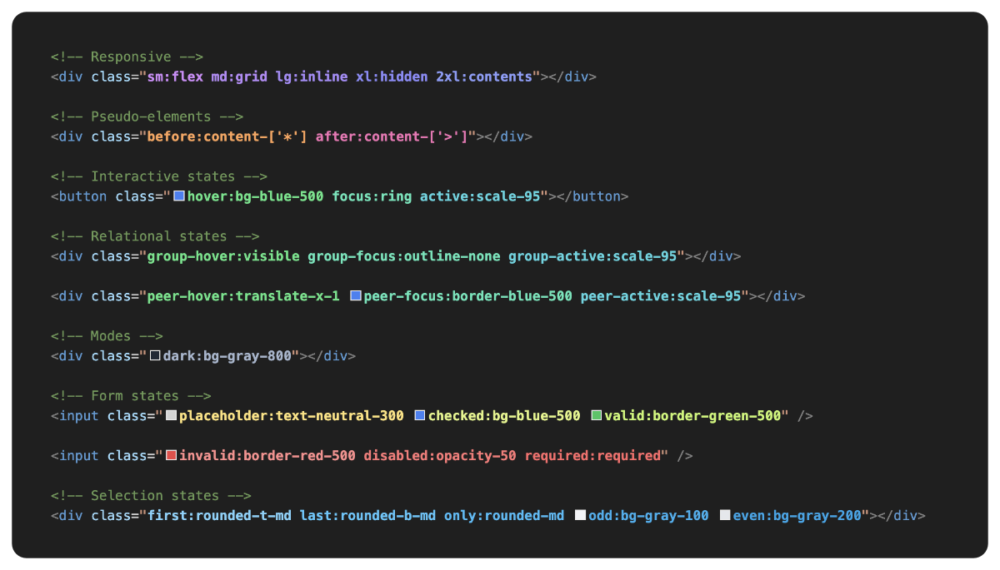

# Tailwind Rainbow

A VS Code extension that provides syntax highlighting for Tailwind CSS classes with customizable coloring themes.

<p align="center">
  
</p>

## Features

- 🟣 **Prefix-based coloring**: Colors Tailwind prefixes (hover, focus, sm, lg, etc.) individually
- 🔵 **Arbitrary values**: Highlights arbitrary prefix values and standalone arbitrary classes
- 🟠 **Optional base class support**: Highlights base classes with wildcard patterns (`bg-*`, `text-*`, etc.)
- 🟡 **Smart detection**: Works in HTML, JSX, template literals, CSS @apply directives, and more
- 🟢 **Fully configurable**: Customize patterns, functions, and detection logic
- 🔴 **Important classes**: Highlights the `!` in both `!flex` and `flex!`

### Class Structure Analysis

The extension recognizes two main types of Tailwind constructs:

1. **Prefixes** - Modifiers that end with a colon (`:`)

   - Examples: `hover:`, `sm:`, `dark:`, `group-hover:`
   - Checked against the `prefix` section of the theme

2. **Base Classes** - Standalone utility classes without colons
   - Examples: `bg-blue-500`, `text-lg`, `min-w-[100px]`
   - Checked against the `base` section of the theme

### Coloring Logic Examples

These are only examples. The default themes **do not** contain any entries in the base section.

#### Single Classes

```
/* Base class - uses base section */
bg-blue-500          → matches "bg-*" pattern in base section

/* Arbitrary class - uses arbitrary color */
[aspect-ratio:1/8]   → uses arbitrary color

/* Prefixed class - prefix color applies to entire class */
hover:bg-red-500     → "hover" color from prefix section
```

#### Multi-Prefix Classes

```
/* Each prefix gets its own color, last prefix colors the rest */
lg:checked:hover:bg-blue-500
├─ lg:               → "lg" color from prefix section
├─ checked:          → "checked" color from prefix section
└─ hover:bg-blue-500 → "hover" color from prefix section
```

#### Advanced Multi-Token Coloring

```
/* When both prefix and base class have theme entries */
lg:min-w-[1920px]
├─ lg:               → "lg" color (from prefix section)
└─ min-w-[1920px]    → "min-*" color (from base section)
```

### Wildcard Pattern Matching

Use the first part of a class name followed by `-*`, such as `bg-*` or `min-*`:

#### Prefix Wildcards

- `min-*` in prefix section matches: `min-lg:`, `min-xl:`, `min-[480px]:`
- Exact matches take priority: `min-lg` config overrides `min-*` config

#### Base Class Wildcards

- `bg-*` in base section matches: `bg-red-500`, `bg-[#ff0000]`, `bg-gradient-to-r`
- `min-*` in base section matches: `min-w-full`, `min-h-[100px]`

### Arbitrary Value Handling

```
/* Standalone arbitrary classes */
[aspect-ratio:1/8]     → arbitrary color

/* Arbitrary prefixes */
[&.show]:block        → arbitrary color
```

### Configuration Priority

The extension follows a specific lookup order for maximum flexibility:

**For Prefixes:**

1. Arbitrary color (for bracket-enclosed prefixes)
2. Exact match in prefix section
3. Match without ignored modifiers (e.g., `group-hover` → `hover`)
4. Match without group name (e.g., `hover/button` → `hover`)
5. Wildcard pattern match in prefix section

**For Base Classes:**

1. Arbitrary color (for bracket-enclosed classes)
2. Exact match in base section
3. Wildcard pattern match in base section

## Supported File Types

- HTML, JavaScript, TypeScript
- React (JSX/TSX), Vue, Svelte, Astro
- PHP templates
- CSS, SCSS, Sass, Less, Stylus, PostCSS
- Template literals and CSS-in-JS

## Installation

Requires **VS Code 1.96 or newer**.

1. Open **Extensions** in VS Code (`Ctrl+Shift+X` / `Cmd+Shift+X`)
2. Search for **Tailwind Rainbow** by **esdete** and click **Install**, or use the [Marketplace page](https://marketplace.visualstudio.com/items?itemName=esdete.tailwind-rainbow)
3. Open a file with Tailwind CSS classes; highlighting starts automatically

If you have a downloaded `.vsix` file, open the Command Palette (`Ctrl+Shift+P` / `Cmd+Shift+P`), run **Extensions: Install from VSIX…** and select the file. Reload VS Code if prompted.

## Configuration

### Switching Themes

1. Open Command Palette (`Ctrl+Shift+P` / `Cmd+Shift+P`)
2. Type "Tailwind Rainbow: Select Theme"
3. Choose from available themes: `default`, `synthwave`

### Supported Languages

Configure which file types to process:

```json
{
  "tailwindRainbow.languages": [
    "html",
    "javascript",
    "typescript",
    "javascriptreact",
    "typescriptreact",
    "vue",
    "svelte",
    "astro",
    "php",
    "css",
    "scss",
    "sass",
    "less",
    "stylus",
    "postcss",
    "tailwindcss"
  ]
}
```

### Custom Themes

Create or override themes with the following structure:

```json
{
  "tailwindRainbow.themes": {
    "myTheme": {
      "prefix": {
        "hover": { "color": "#ff0000", "fontWeight": "bold" },
        "focus": { "color": "#00ff00", "fontWeight": "normal" },
        "sm": { "color": "#0000ff" },
        "lg": { "color": "#ffff00" }
      },
      "base": {
        "bg-*": { "color": "#ff6600", "fontWeight": "semibold" },
        "text-*": { "color": "#6600ff" },
        "p-*": { "color": "#00ffff" }
      },
      "arbitrary": { "color": "#ff00ff", "fontWeight": "bold" },
      "important": { "color": "#ff0000", "fontWeight": "bold" }
    }
  },
  "tailwindRainbow.theme": "myTheme"
}
```

### Advanced Configuration

#### Class Detection Patterns

Customize how classes are detected in different contexts:

These lists replace the defaults, so include any existing names you want to keep. Highlighting applies to class attributes, configured helper functions and tagged templates; ordinary strings are left unchanged.

```json
{
  "tailwindRainbow.classIdentifiers": ["class", "className", "class:", "className:", "classlist", "classes", "css", "style"],
  "tailwindRainbow.classFunctions": ["cn", "clsx", "cva", "classNames", "classList", "twMerge", "tw", "styled", "css"],
  "tailwindRainbow.templatePatterns": ["class", "tw`", "css`", "styled"],
  "tailwindRainbow.contextPatterns": ["variants", "cva", "class", "css", "style", "@apply"]
}
```

#### Ignored Prefix Modifiers

Configure which prefix modifiers to ignore during parsing. For example, when using Tailwind's `group-hover` pattern the extension will ignore the `group` modifier and color the entire prefix with the `hover` color:

```json
{
  "tailwindRainbow.ignoredPrefixModifiers": ["group", "peer", "has", "in", "not"]
}
```

## Extension API

Other extensions can register custom themes:

```ts
// Wait for activation
const tailwindRainbow = vscode.extensions.getExtension('esdete.tailwind-rainbow');
if (tailwindRainbow && !tailwindRainbow.isActive) {
  await tailwindRainbow.activate();
}

// Register theme
const api = tailwindRainbow?.exports;
if (api) {
  api.registerTheme('myCustomTheme', {
    prefix: {
      hover: { color: '#ff0000', fontWeight: 'bold' },
      // ... more prefixes
    },
    base: {
      'bg-*': { color: '#00ff00' },
      // ... more base patterns
    },
    arbitrary: { color: '#0000ff' },
    important: { color: '#ff00ff' },
  });
}
```

## Contributing

You have an idea for a new feature or found a bug? Feel free to open an issue or submit a pull request!

- Report bugs or request features via [GitHub Issues](https://github.com/esdete2/tailwind-rainbow/issues)
- Submit pull requests with improvements
- Share your custom themes with the community

## License

Apache 2.0 License - see the [LICENSE](LICENSE) file for details
